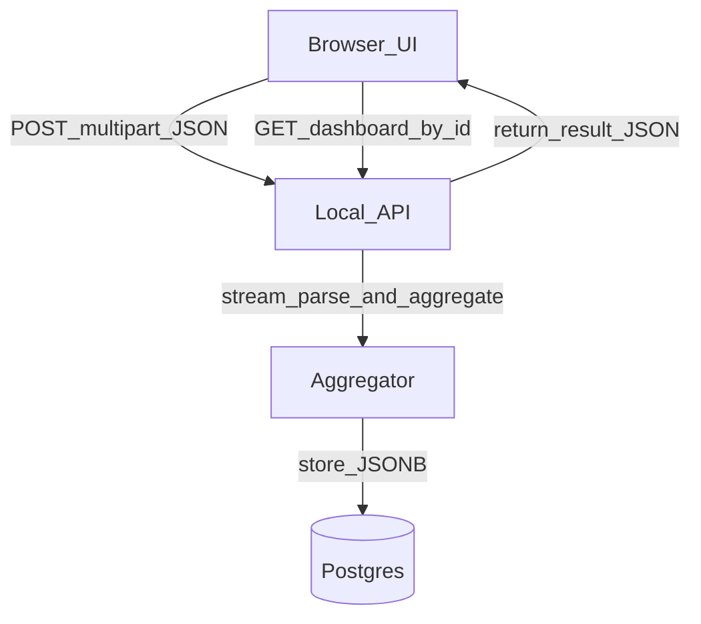

# バッチアップロード対応のDB+バックエンド設計（ローカルMVP）

## ゴール

- 500MB級のJSONを**ブラウザだけに依存せず**処理できるように、ローカルで **API + DB** を用意する
- **保存するのはダッシュボード集計のみ**（生detectionsは保存しない）
- UIは現状の `data.worker.ts` 相当のアウトプットを **APIから取得**して表示できるようにする

## 重要な設計方針（本件の肝）

- **ストリーミング取り込み**: サーバで `JSON.parse` しない（500MBでメモリ圧迫）。アップロードボディをストリームで読み、フレーム単位に逐次集計する
- **集計結果キャッシュのみ永続化**: `summaryMetrics` / `arrivalTrendData` / `aggregatedTimeSeries` / `seatUsageTimeline` / `interpolatedOccupancyData` / （必要なら）`processedFrames` を1レコードにJSONで保存
- **同期処理**: `POST /datasets` はアップロード完了後、集計が終わるまで待ってレスポンス（ローカル用途でシンプル）

## 変更/追加する主要ファイル

- バックエンド
- `server/index.ts`（Fastify推奨、1ファイルから開始）
- `server/ingest/streamAggregate.ts`（ストリーミングパース→集計）
- `server/db/schema.sql`（テーブル定義）
- インフラ
- `docker-compose.yml`（Postgres）
- `.env.example`（DB接続）
- フロント
- [` ```/Users/yuukun/.cursor/worktrees/dashboard-feature/oet/components/FileUpload.tsx``` `](/Users/yuukun/.cursor/worktrees/dashboard-feature/oet/components/FileUpload.tsx)（ファイルをAPIへ送る）
- [` ```/Users/yuukun/.cursor/worktrees/dashboard-feature/oet/App.tsx``` `](/Users/yuukun/.cursor/worktrees/dashboard-feature/oet/App.tsx)（worker処理をAPIレスポンスに差し替え）
- [` ```/Users/yuukun/.cursor/worktrees/dashboard-feature/oet/types.ts``` `](/Users/yuukun/.cursor/worktrees/dashboard-feature/oet/types.ts)（APIレスポンス型を共有）

## DBスキーマ（最小）

- `datasets`
- `id` (uuid)
- `original_filename` (text)
- `created_at` (timestamptz)
- `processing_ms` (int)
- `result` (jsonb)  ← 集計結果を丸ごと保存

※分離不要・集計だけ保存なので1テーブルで成立。将来、履歴管理や複数結果を持ちたくなったら `dataset_results` を分離。

## API（最小）

- `POST /datasets`
- multipartでファイルを受け取り（`file`）、ストリーミング集計して `datasets.result` に保存
- レスポンス: `{ datasetId }`
- `GET /datasets/:id/dashboard`
- レスポンス: `datasets.result`（現在のworkerの返却構造と同型）

## データフロー（概要）




## ストリーミング集計の実装方針

- トップレベルが `{ frameKey: [detections...] } `のため、NodeのストリーミングJSONパーサ（例: `stream-json` 系）で
- `frameKey` ごとの検出配列を**一度に保持せず**逐次取り出す
- その場で以下を更新
    - 時系列バケット（1min/15min/hourのmax）
    - arrival trend（hourly bucketで newVisitors/newGroups）
    - peak occupancy
    - seat usage timeline（状態遷移・absence閾値）
- 現状の集計ロジックは [` ```/Users/yuukun/.cursor/worktrees/dashboard-feature/oet/data.worker.ts``` `](/Users/yuukun/.cursor/worktrees/dashboard-feature/oet/data.worker.ts) にあるので、まずは**同じ出力**をサーバ側で生成する

## フロント差し替え方針

- いまは `FileUpload.tsx` がファイルを読み込んで `App.tsx` がworkerに `jsonString` を渡している
- これを
- `FileUpload.tsx` → `fetch(POST /datasets, FormData)` に変更
- `App.tsx` → `datasetId` を保持し `GET /datasets/:id/dashboard` を取得して `Dashboard` に渡す

に置き換える（UIのグラフ描画は基本そのまま）

## 受け入れ条件

- 500MBのJSONをアップロードして、ブラウザ側が落ちずにダッシュボードが表示できる
- 集計結果がPostgresに保存され、同じ `datasetId` で再取得できる

## 実装Todos

- `setup-postgres`: Postgresをdocker-composeで追加し、接続設定を用意
- `add-api-server`: Fastifyサーバを追加し、`POST /datasets` と `GET /datasets/:id/dashboard` を実装