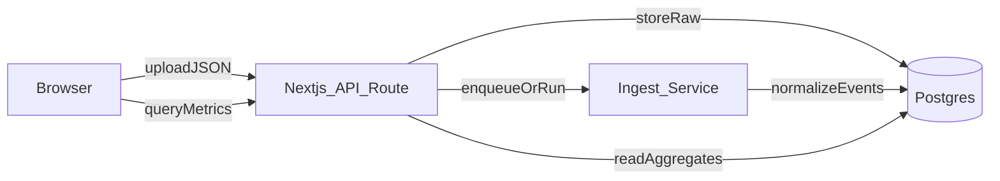

# Next.js+Postgresでの取り込み/集計基盤プラン

## 目的

- いまフロント（Vite + WebWorker）でやっている **全件パース/集計** をサーバ側に移し、データが追記で増えても破綻しない構成にする。
- JSONの `timestamp` は“スクリプト実行時刻”由来で信用しない前提とし、**開始=2025-06-30 10:00、終了=15:06** に合わせて **frame_number を実時間へ線形フィット**して `event_time` を生成する。

## 現状の重要な観察（移行対象）

- フロントは `App.tsx` でJSON文字列を受け取り、`data.worker.ts` が `ProcessedFrame` を生成し、
- 時系列集計（1min/15min/hour）
- 席の滞在ブロック（`generateSeatUsageTimeline`）
- 補間した席占有のタイムライン

を全フレーム走査で作っています（規模が増えると限界）。

- 参照: `data.worker.ts`（集計/ブロック生成）

## アーキテクチャ（MVP）

- **Next.js**: UI + API Routes（取り込み/検索/集計）
- **Postgres**: Raw保管 + 正規化テーブル + 集計クエリ
- **取り込み**: MVPは同期でも開始できるが、追記・巨大化を見据えてジョブ化（状態: queued/running/done/failed）を前提に設計

## データモデル（最小）

### 1. imports（取り込み単位）

- `id`
- `source_name`（ファイル名など）
- `status`（queued/running/done/failed）
- `start_time_real`（固定: 2025-06-30 10:00 を指定可能に）
- `end_time_real`（固定: 15:06 を指定可能に）
- `time_mapping`（線形フィット情報: durationSeconds, maxFrameNumber, method="linear"）
- `created_at`

### 2. raw_frames（Raw保持: 再処理/監査用）

- `import_id`
- `frame_key`（例: frame_001）
- `frame_number`
- `raw_payload`（jsonb; そのフレームの検出配列）

### 3. detections（正規化: クエリ/集計用）

- `import_id`
- `frame_number`
- `event_time`（実時間: 線形フィット結果）
- `person_id`
- `seat_id`（`confirmed_seat_id || raw_seat_id`）
- `confidence`
- `bbox`（必要なら）

### インデックス方針

- `detections(import_id, event_time)`（期間フィルタ）
- `detections(import_id, seat_id, event_time)`（席別）
- `detections(import_id, person_id, event_time)`（人物別/グループ導出）

## 実時間の線形フィット仕様

- 入力:
- `start_time_real = 2025-06-30 10:00:00`
- `end_time_real = 2025-06-30 15:06:00`
- `max_frame_number`（JSON内の最大frame_number）
- 変換:
- `t = (frame_number - min_frame)/(max_frame-min_frame)`
- `event_time = start_time_real + t * (end_time_real - start_time_real)`
- 注意:
- 後から `end_time_real` が変わっても再計算できるよう、**補正パラメータをimportsに保存**

## API設計（画面で必要なものから）

- **取り込み**
- `POST /api/imports`（JSONアップロード or 既存ファイル参照）
- `GET /api/imports/:id`（進捗/エラー）
- **イベント/一覧**
- `GET /api/detections?importId=&from=&to=&seatId=&q=&cursor=`
- **集計**
- `GET /api/metrics/occupancy?importId=&from=&to=&bucket=hour|15min|day|month`
- `GET /api/metrics/seatUsage?importId=&from=&to=`（席別滞在ブロック相当）

## UI移行方針

- 現在の `components/Dashboard.tsx` は「受け取った集計済みデータを描画」する責務に寄せる。
- `components/FileUpload.tsx` の「startTime入力」は、Next.js側では **import設定（start/end）** として扱う。
- ViteアプリからNext.jsへ段階移行:
- まずNext.jsを新設し、既存コンポーネントを移植
- WebWorker集計は廃止し、APIから集計済みレスポンスを取得

## レポジトリ構成案（このworkspaceを基に）

- `apps/web`（Next.js）
- `packages/shared`（型定義/集計DTOなど共通）
- もしくは単一Next.jsに寄せて簡素化（MVP優先）

## 実装で触る主要ファイル（現状からの移行元）

- [`/Users/yuukun/.cursor/worktrees/dashboard-feature/cxr/data.worker.ts`](/Users/yuukun/.cursor/worktrees/dashboard-feature/cxr/data.worker.ts)（集計ロジックの移植元）
- [`/Users/yuukun/.cursor/worktrees/dashboard-feature/cxr/types.ts`](/Users/yuukun/.cursor/worktrees/dashboard-feature/cxr/types.ts)（型の移植元）
- [`/Users/yuukun/.cursor/worktrees/dashboard-feature/cxr/components/Dashboard.tsx`](/Users/yuukun/.cursor/worktrees/dashboard-feature/cxr/components/Dashboard.tsx)（描画コンポーネントの移植元）
- [`/Users/yuukun/.cursor/worktrees/dashboard-feature/cxr/components/FileUpload.tsx`](/Users/yuukun/.cursor/worktrees/dashboard-feature/cxr/components/FileUpload.tsx)（アップロードUXの移植元）

## 実装タスク（MVP）

- Next.jsプロジェクト新設（App Router）
- Postgres（docker-compose）とマイグレーション導入（Prisma or Drizzleを採用）
- `imports`/`raw_frames`/`detections` のスキーマ作成
- JSON取り込みAPI（アップロード→パース→DB保存）
- 線形フィットで `event_time` を計算し `detections` へ正規化
- 集計API（時間バケット、席別、日別/月別/時間帯別）
- 既存DashboardのデータソースをAPIに差し替え

## まずの非MVP（後で）